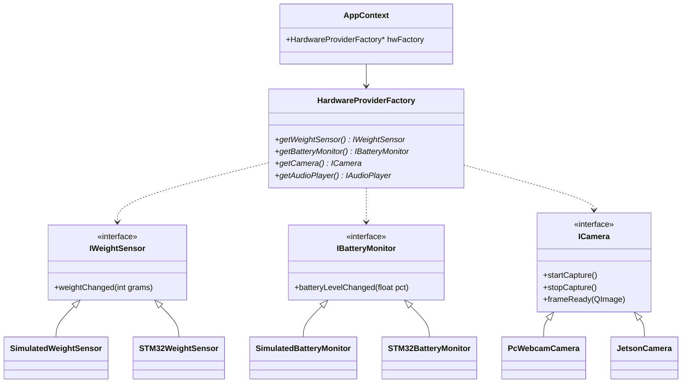

# Hardware Abstraction Layer (HAL)

This document describes the Phase 7A implementation of the Hardware Abstraction Layer (HAL) using Dependency Injection, which strictly decouples business logic from hardware implementations.

## How to Swap Hardware (Example)
To swap from Simulator mode to full hardware mode, simply modify `AppContext::initialize` to pass `HardwareMode::PRODUCTION_STM32_JETSON` instead of `HardwareMode::SIMULATOR` when instantiating the `HardwareProviderFactory`. No business logic in `ShoppingService` or `TelemetryService` needs to change, as they rely entirely on the abstract interfaces returned by the factory.